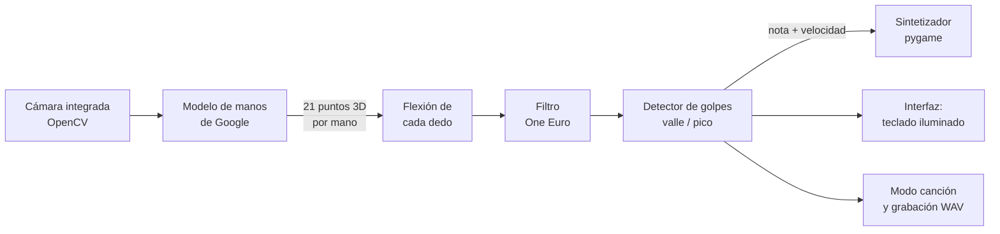

# ♪ Piano Virtual con Manos

**Autor:** Sebastian Lizcano · Ciencia de Datos e Inteligencia Artificial

Toca un piano **doblando los dedos frente a la cámara del PC**, sin tocar nada.
No necesita Kinect ni sensores: solo la cámara integrada del portátil y un modelo de
**visión por computador** que detecta **21 puntos clave en 3D por cada mano**.

Cada dedo es una tecla: los 5 dedos de la mano izquierda tocan las notas graves y los de la
derecha las agudas. Al doblar un dedo con rapidez, como si presionaras una tecla, suena su nota.
Si golpeas más rápido, la nota suena más fuerte. Incluye un **modo canción** que te guía nota por
nota (Jingle Bells, Para Elisa, Himno de la Alegría...) y **grabación a WAV**.

---

## Base: el modelo de manos de Google

El proyecto está construido sobre **MediaPipe Hand Landmarker**, el modelo de manos de Google,
entrenado con el **dataset de manos de Google**: imágenes reales anotadas a mano con 21 puntos
clave más un gran conjunto de manos sintéticas renderizadas en 3D
([Zhang et al., 2020](https://arxiv.org/abs/2006.10214)).

**No hace falta entrenar nada en Colab.** Como en el **aprendizaje por transferencia**, se reutiliza
un modelo ya entrenado y sobre él se construye toda la lógica propia: flexión 3D de los dedos,
detección de golpes, sintetizador, modo canción y selección de cámara.

Por dentro, el modelo combina dos ideas vistas en el curso:

| Etapa del modelo | Qué hace | Tema del curso |
| :-- | :-- | :-- |
| Detector de palma (CNN tipo SSD) | Encuentra dónde hay una mano (caja) | Detección de objetos (YOLOv8) |
| Modelo de puntos clave (CNN) | Regresión de 21 coordenadas (x, y, z) | Detección de puntos clave (MobileNetV2) |

---

## Aportes de este proyecto

La mayoría de pianos virtuales con cámara usan la altura de la punta del dedo en la imagen y
archivos de audio pregrabados. Este proyecto cambia el enfoque y agrega funciones nuevas:

| Aspecto | Enfoque común | **Este proyecto** |
| :-- | :-- | :-- |
| Cómo detecta una "tecla" | Altura o velocidad de la punta del dedo en la imagen (2D) | **Flexión 3D del dedo**: ángulos de sus articulaciones (producto punto) |
| Si se mueve toda la mano | Las puntas se mueven juntas y suenan varias notas | **No suena nada**: la flexión no cambia al mover o girar la mano (lo verifica una prueba automática) |
| Calibración | Umbral fijo en píxeles | **Automática por dedo** (aprende tu postura de reposo) y sensibilidad ajustable en vivo |
| Suavizado | Ninguno o promedio fijo | **Filtro One Euro**: quita el temblor sin retrasar el golpe |
| Repetir una nota | Tiempo de espera fijo | **Histéresis pico/valle**: se puede repetir sin estirar el dedo del todo |
| Sonido | Archivos mp3/wav pregrabados | **Sintetizador propio** (síntesis aditiva): cualquier nota, sin archivos de audio |
| Intensidad | Volumen fijo | **Volumen según la velocidad del dedo**, como un teclado MIDI |
| Notas | 10 notas fijas | **4 escalas** (mayor, pentatónica, menor, blues) y **cambio de octava** en vivo |
| Canciones | — | **Modo canción guiado**; si una canción necesita otras notas, **los dedos cambian de notas solos** |
| Interfaz | Puntos sobre la imagen | **Teclado de piano que se ilumina**, anillo de "carga" en cada dedo, panel de flexión y ayuda |
| Cámara | `cv2.VideoCapture(0)`: la primera que aparezca (puede ser virtual) | **Siempre la cámara integrada**, identificada por su hardware; MJPG 1280×720 a 30 FPS |
| Calidad | — | **Grabación a WAV** y **15 pruebas automáticas** |
| API de MediaPipe | `mp.solutions` (eliminada en MediaPipe 1.0) | API actual **Tasks** (`HandLandmarker`) |

### Resultados medidos

| Medida | Resultado |
| :-- | :-- |
| Velocidad con la cámara integrada (IA incluida, solo CPU) | **≈ 26 imágenes por segundo** (en batería con ahorro de energía puede bajar a la mitad) |
| Apertura de la cámara | **0,5 s** (configurándola después de abrirla tardaba de 3 a 7 s) |
| Imagen de la cámara | **1280×720 a 30 FPS** (sin MJPG la cámara solo entregaba ~10 FPS en 720p) |
| Latencia del audio | búfer de 512 muestras (≈ 12 ms) |
| Pruebas automáticas | **15 de 15** superadas |

---

## Cómo funciona



**1. Puntos clave.** Para cada mano, el modelo entrega 21 puntos en la imagen y los mismos 21 puntos
en **coordenadas 3D reales (metros)**. Se usan los puntos 3D: no dependen de la distancia a la cámara.

**2. Flexión del dedo.** En cada articulación se mide el ángulo entre el hueso anterior
$\vec{u}$ y el siguiente $\vec{v}$ con el producto punto:

$$\theta = \arccos\left(\frac{\vec{u}\cdot\vec{v}}{\lVert\vec{u}\rVert\,\lVert\vec{v}\rVert}\right)
\qquad\qquad F_{dedo} = \theta_{nudillo} + \theta_{medio} + \theta_{punta}$$

Un dedo totalmente recto da $F = 0°$ y al doblarlo el valor crece (con el puño cerrado supera los
$150°$). Como solo depende de ángulos **internos** de la mano, moverla o girarla no cambia $F$.

**3. Filtro One Euro.** Suaviza $F$ con una frecuencia de corte que se adapta a la velocidad: si el
dedo está quieto filtra mucho (adiós temblor) y si se mueve rápido filtra poco (sin retraso).

**4. Detector de golpes con histéresis.** Para cada dedo se sigue su *valle* (punto más estirado
reciente; baja al instante y sube lento para adaptarse a la postura de cada persona):

- Suena la nota si $F - \text{valle} > \text{umbral}$ (30°, pulgar 26°) **y** el dedo se dobla a más de 60°/s.
- El dedo queda listo para repetir cuando retrocede el 40 % del umbral desde su pico.

Así se evitan notas falsas por temblor, por cambios lentos de postura y por repeticiones dobles.

**5. Música.** Cada dedo tiene un grado de la escala elegida. La nota MIDI $m$ se convierte en
frecuencia con $f = 440 \cdot 2^{(m-69)/12}$ y el sintetizador genera un sonido tipo piano:

$$y(t) = \sum_{k} A_k\, e^{-\lambda_k t}\,\sin(2\pi f_k t), \qquad f_k = k\,f_0\sqrt{1 + B k^2}$$

con armónicos levemente desafinados (cuerdas rígidas), el 7.º armónico atenuado (el martillo golpea
a 1/7 de la cuerda), decaimiento más rápido en los agudos y un breve ruido de martillo.
La velocidad del dedo controla el volumen.

---

## Cámara: siempre la integrada

Con `cv2.VideoCapture(0)` OpenCV abre la cámara que Windows ponga primero, y ese orden cambia
según el sistema de captura e incluye cámaras virtuales. En el portátil donde se desarrolló:

| Índice (DirectShow) | Cámara | Tipo |
| :-: | :-- | :-- |
| 0 | Sharing Camera | virtual (programa para compartir pantalla) |
| 1 | **Integrated Camera** | **cámara integrada del portátil** |
| 2 | OBS Virtual Camera | virtual (OBS) |

Por eso el módulo `camara.py` **no usa números**: lista las cámaras con su identificador de hardware
(sin encenderlas) y le pregunta a Windows la **ubicación física** de cada una (dato ACPI `_PLD` que
pone el fabricante). Solo la cámara de fábrica la tiene, por ejemplo *"en la tapa, panel frontal"*.
Las cámaras virtuales (bus `ROOT`/`SWD`) y las webcams USB externas quedan descartadas.

- Si la cámara integrada no está disponible, el programa **avisa y se cierra**; nunca abre otra.
- La cámara se abre en formato **MJPG 1280×720 a 30 FPS** (con los ajustes por defecto de Windows
  quedaba en YUY2 a ~10 FPS y tardaba varios segundos en abrir).
- Si la imagen llega negra, el piano avisa (por ejemplo, si la tapa de privacidad está cerrada).

Para ver qué cámaras hay y cuál se usa:

```bash
python app.py --listar-camaras
```

---

## Instalación

Requisitos: Windows, macOS o Linux con cámara. Probado con **Python 3.11** en Windows 11.

**Opción rápida (Windows):** doble clic en **`Piano.bat`**. La primera vez crea el entorno virtual e
instala todo (necesita internet); las siguientes abre el piano directamente.

**Opción manual (PowerShell):**

```bash
cd Piano-Virtual-Manos
py -3.11 -m venv .venv
.\.venv\Scripts\Activate.ps1
pip install -r requirements.txt
python app.py
```

El modelo `modelos/hand_landmarker.task` (7.8 MB) ya está incluido. Si se borra, el programa lo vuelve
a descargar solo desde el servidor oficial de Google.

---

## Cómo tocar

1. Siéntate a unos 50–70 cm de la cámara, con buena luz.
2. Levanta las manos a la altura del pecho, con los dedos relajados y separados
   (palmas hacia la cámara o hacia abajo).
3. **Dobla un dedo rápido**, como si presionaras una tecla. El anillo de color en la punta del dedo
   se llena a medida que te acercas al umbral.
4. Si suena poco, sube la sensibilidad con `]`; si suenan dedos vecinos, bájala con `[`.
   La tecla `D` muestra la flexión de cada dedo frente a su umbral.

**Notas de cada dedo (escala Do mayor, octava 4):**

| Mano izquierda | Meñique | Anular | Medio | Índice | Pulgar |
| :-- | :-: | :-: | :-: | :-: | :-: |
| Nota | Do4 | Re4 | Mi4 | Fa4 | Sol4 |

| Mano derecha | Pulgar | Índice | Medio | Anular | Meñique |
| :-- | :-: | :-: | :-: | :-: | :-: |
| Nota | La4 | Si4 | Do5 | Re5 | Mi5 |

### Teclas

| Tecla | Acción |
| :-- | :-- |
| `E` | Cambiar escala: Do mayor → Pentatónica → Do menor → Blues |
| `↑` `↓` o `+` `-` | Subir / bajar una octava (2 a 6) |
| `[` `]` | Bajar / subir la sensibilidad (50 % a 200 %) |
| `C` | Modo canción: pasa a la siguiente canción y, después de la última, vuelve al modo libre |
| `Espacio` | Reiniciar la canción |
| `R` | Grabar; al pulsar otra vez se guarda `grabaciones/piano_FECHA.wav` |
| `D` | Panel de flexión de los dedos |
| `M` | Silenciar |
| `F` | Pantalla completa |
| `H` | Ayuda en pantalla |
| `Q` / `Esc` | Salir |

### Modo canción

El piano marca la siguiente nota en el teclado (▼), resalta el dedo que debes usar y muestra las
próximas notas. Al terminar muestra la **precisión** y el **tiempo**. Si en el mismo instante suena la
nota correcta junto con un dedo vecino, cuenta como acierto.

| Canción | Notas de los dedos |
| :-- | :-- |
| Escala de Do (calentamiento) | normales |
| Himno de la Alegría (Beethoven) | normales |
| Estrellita, ¿dónde estás? | normales |
| Jingle Bells | normales |
| Para Elisa (Beethoven) | **cambian solas**: usa Re♯ y Sol♯ y 12 notas distintas |

**Los dedos cambian de notas solo cuando hace falta.** Si una canción cabe en las notas normales, no
cambia nada. Si necesita otras notas (sostenidos, bemoles u otra octava), cada dedo recibe una nota
de la canción. Y si la canción usa más de 10 notas distintas, se divide en partes: al empezar una
frase nueva aparece el aviso *"Cambian las notas de los dedos (parte 2 de 2)"* y el teclado y las
etiquetas de los dedos se actualizan. En *Para Elisa* la mano derecha conserva sus notas y solo
cambia la izquierda.

### Agregar tus canciones

En `canciones.py` cada canción es un texto con sus notas, una frase por línea. Se puede escribir en
**solfeo** (`Mi5 Re#5 Sib4`), en **letras** (`E5 D#5 Bb4`) o con los **números de una tablatura de
kalimba** (`3° 2° 3° 7 1°`; 1 = Do4, cada ° sube una octava, y un acorde como `(135)` toma su nota
más aguda). Ya hay un espacio reservado para **El Castillo Ambulante**: al pegar su melodía, la
canción aparece sola en el modo canción y los dedos se adaptan a sus notas.

### Opciones de la línea de comandos

```bash
python app.py --listar-camaras    # ver las cámaras detectadas y cuál es la integrada
python app.py --panel             # iniciar con el panel de flexión visible
python app.py --video demo.mp4    # probar con un video en vez de la cámara
python app.py --sin-sonido        # sin audio
python app.py --sin-espejo        # sin efecto espejo
```

---

## Estructura del proyecto

```text
Piano-Virtual-Manos/
├── app.py            # programa principal: bucle, teclas, ventana
├── camara.py         # encuentra y abre SOLO la cámara integrada (hardware ACPI)
├── manos.py          # modelo de manos, flexión 3D, filtro One Euro y detector de golpes
├── sonido.py         # sintetizador de piano, reproducción (pygame) y grabación WAV
├── interfaz.py       # dibujo: teclado, manos, paneles, ayuda (OpenCV)
├── canciones.py      # canciones, lector de notas (solfeo, letras, kalimba) y cambio de notas
├── config.py         # todos los parámetros ajustables (umbrales, colores, escalas)
├── test_piano.py     # pruebas automáticas (no necesitan cámara)
├── Piano.bat         # lanzador con doble clic para Windows
├── requirements.txt
└── modelos/
    └── hand_landmarker.task   # modelo de manos preentrenado de Google
```

## Pruebas

```bash
python test_piano.py
```

Son 15 pruebas que verifican, entre otras cosas, que **mover o girar la mano no cambia la flexión**,
que un golpe rápido toca **exactamente una** nota, que el temblor y doblar el dedo despacio **no**
tocan notas, que se puede repetir una nota sin estirar el dedo, que **solo se elige la cámara
integrada** (aunque una virtual esté primero), que **cada nota de cada canción cae en un dedo**, que
las notas **solo cambian cuando la canción lo necesita**, la lectura de notas en los tres formatos,
la síntesis de todas las notas y la grabación WAV.

---

## Conceptos aplicados

- **Redes convolucionales y puntos clave:** el modelo usa CNN para detectar la palma y hacer la
  regresión de 21 coordenadas 3D.
- **Modelos preentrenados / aprendizaje por transferencia:** se reutiliza un modelo ya entrenado
  con el dataset de manos de Google.
- **Inferencia en tiempo real:** unas 26 imágenes por segundo en la CPU de un portátil.
- **Álgebra lineal:** producto punto y normas para medir ángulos 3D.
- **Procesamiento de señales:** filtro One Euro, umbrales con histéresis y síntesis aditiva de sonido.
- **Ingeniería de software:** código modular, configuración centralizada y pruebas automáticas.

## Próximas mejoras

- **Cuerpo completo:** con el modelo de pose de MediaPipe (33 puntos del cuerpo) se podrían tocar
  instrumentos de percusión con los brazos y las piernas.
- **Gestos propios:** entrenar en Colab un clasificador de gestos (por ejemplo, para cambiar de escala
  con un gesto) a partir de los 21 puntos de la mano.
- **Salida MIDI:** enviar las notas a programas musicales para usar sonidos de piano reales.

---

## Solución de problemas

| Problema | Solución |
| :-- | :-- |
| "No se encontró la cámara integrada" | La cámara está desactivada: revisa la tecla o el interruptor de privacidad del portátil, el Administrador de dispositivos y Configuración > Privacidad > Cámara. `python app.py --listar-camaras` muestra qué ve el programa |
| "La cámara integrada está ocupada" | Cierra Teams, Zoom, Meet, la app Cámara u otra que la esté usando |
| La imagen sale negra | Abre la tapa de privacidad de la cámara o mejora la luz |
| `module 'mediapipe' has no attribute 'solutions'` | Ocurre con código antiguo: las versiones nuevas de MediaPipe eliminaron `mp.solutions`. Este proyecto usa la API nueva (`HandLandmarker`) |
| Errores raros de `cv2` | Tener `opencv-python` y `opencv-contrib-python` a la vez genera conflictos: `pip uninstall opencv-python` y reinstala `requirements.txt` |
| No suena | Revisa el volumen y la salida de audio de Windows; verifica que no esté silenciado (`M`) |
| Suenan notas de más / de menos | Ajusta la sensibilidad con `[` `]` y revisa el panel `D` |
| Va lento | Conecta el cargador (en batería Windows reduce la velocidad del procesador), cierra programas pesados como el navegador, mejora la luz y deja visibles solo tus manos |

## Créditos

- Modelo y dataset de manos de Google:
  [MediaPipe Hand Landmarker](https://ai.google.dev/edge/mediapipe/solutions/vision/hand_landmarker);
  Zhang et al. (2020), *MediaPipe Hands: On-device Real-time Hand Tracking*, [arXiv:2006.10214](https://arxiv.org/abs/2006.10214).
- Filtro One Euro: Casiez, Roussel y Vogel (2012), *1€ Filter: A Simple Speed-based Low-pass Filter for Noisy Input in Interactive Systems*.
- Canciones incluidas de dominio público: *Himno de la Alegría* y *Para Elisa* (Beethoven),
  *Estrellita* (melodía tradicional) y *Jingle Bells* (James Lord Pierpont).
